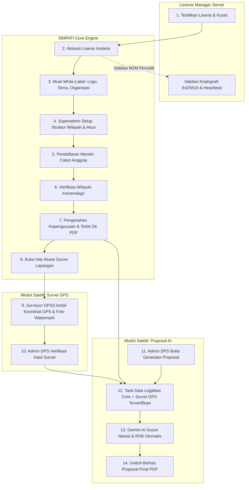
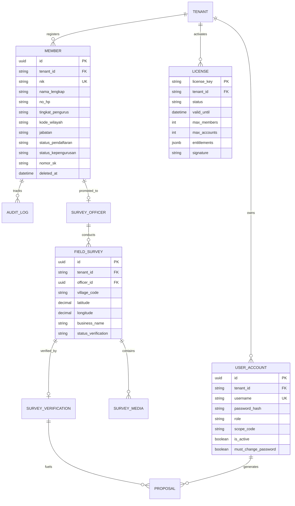

# SYSTEM BLUEPRINT: SIMPATI UNIVERSAL PLATFORM
**Dokumen Audit Sistem, Logika Bisnis, Arsitektur & Panduan Greenfield Refactor**
*Disusun oleh: System Auditor & Enterprise Architect*  
*Target Implementasi: Modular Clean Architecture (Core + Satelit)*

---

## DAFTAR ISI
1. [Ringkasan Eksekutif & Visi Rekayasa Ulang](#1-ringkasan-eksekutif--visi-rekayasa-ulang)
2. [Bagian 1: Ringkasan Arsitektur & Alur Kerja (User Flow)](#2-bagian-1-ringkasan-arsitektur--alur-kerja-user-flow)
   - 2.1 Alur End-to-End Sistem SIMPATI
   - 2.2 Hierarki & Hak Akses Pengguna (Nasional s.d. Desa)
   - 2.3 Mekanisme White-Labeling & Isolasi Multi-Tenant
   - 2.4 Mekanisme Lisensi Terpusat (License Manager) & Penegakan Kebijakan
3. [Bagian 2: Daftar Lengkap Fitur & Aturan Bisnis (Business Logic)](#3-bagian-2-daftar-lengkap-fitur--aturan-bisnis-business-logic)
   - 3.1 Klasifikasi: Core System vs Modul Tambahan (Satelit)
   - 3.2 Modul 1: Manajemen Pendaftaran & Keanggotaan Publik
   - 3.3 Modul 2: Struktur Kepengurusan & Validasi Wilayah Nasional
   - 3.4 Modul 3: Penerbitan SK, Surat Keputusan & Dokumen PDF Legal
   - 3.5 Modul 4: Manajemen Pengguna, RBAC & Delegasi Wewenang
   - 3.6 Modul 5: Survei Lapangan Berbasis GPS & Kamera Bukti Nyata
   - 3.7 Modul 6: Verifikasi & Validasi Hasil Survei Wilayah
   - 3.8 Modul 7: Generator Proposal Otomatis Berbasis AI (Gemini Engine)
   - 3.9 Modul 8: Audit Trail, Keamanan & Siklus Soft Delete
4. [Bagian 3: Skema Database & Integrasi Eksternal](#4-bagian-3-skema-database--integrasi-eksternal)
   - 4.1 Inventaris Skema Database Lama
   - 4.2 Desain Entitas Relasional & Indeks Kritis
   - 4.3 Integrasi Layanan Pihak Ketiga & Infrastruktur
5. [Bagian 4: Audit Kode Lama (Tech Debt, Bottleneck & Dead Code)](#5-bagian-4-audit-kode-lama-tech-debt-bottleneck--dead-code)
   - 5.1 Temuan Monolit & Anti-Pattern Kritis
   - 5.2 Fragmentasi Manajemen Akun & Redundansi Data
   - 5.3 Risiko Skalabilitas & Bottleneck Skala Nasional
   - 5.4 Daftar Komponen yang Dilarang Masuk ke Repositori Baru
6. [Bagian 5: Rekomendasi Target Clean Architecture (Greenfield Roadmap)](#6-bagian-5-rekomendasi-target-clean-architecture-greenfield-roadmap)
   - 6.1 Struktur Direktori Standar Hexagonal / Clean Architecture
   - 6.2 Pola Komunikasi Antar-Layanan (Core <-> Satelit)
   - 6.3 Checklist Transisi ke Repositori Baru

---

## 1. Ringkasan Eksekutif & Visi Rekayasa Ulang

Aplikasi SIMPATI (Sistem Informasi Manajemen Pelayanan, Anggota & Teritorial Terintegrasi) dirancang sebagai sistem terpadu untuk organisasi kemasyarakatan, paguyuban, asosiasi, atau partai politik dengan jangkauan nasional. Sistem ini menangani pendaftaran anggota, penetapan dan pengesahan struktur kepengurusan dari tingkat Pusat hingga Desa/Kelurahan, verifikasi lapangan berbasis GPS, serta penyusunan proposal permohonan bantuan UMKM/fasilitas sosial otomatis berbasis AI.

Pada implementasi lama (versi warisan/legacy), sistem terpecah ke dalam 4 repositori terpisah:
1. `pendaftaran555-main`: Monolit aplikasi web pendaftaran anggota, verifikasi wilayah, dan kepengurusan organisasi.
2. `survey-gps-server-main`: Server backend dan dashboard pemantauan survei GPS lapangan, verifikasi data teritorial, dan aplikasi mobile Flutter.
3. `proposal-otomatis-main`: Layanan mikro frontend dan backend untuk penyusunan proposal otomatis dengan model Google Gemini AI.
4. `simpati-license-manager-main`: Server otorisasi lisensi terpusat, manajemen pelanggan/instansi (tenant), kontrol modul, kuota kapasitas, dan penandatanganan kriptografis M2M.

**Tujuan Refactor Greenfield:**  
Membangun fondasi baru dengan pendekatan **Clean Architecture** (Domain-Driven Design) yang modular. Sistem dipecah secara bersih antara **SIMPATI Core** (fondasi keanggotaan, identitas, wilayah, lisensi, dan audit) dengan **Modul Satelit** yang dapat diaktifkan atau dikunci secara dinamis melalui License Entitlement Engine.

---

## 2. Bagian 1: Ringkasan Arsitektur & Alur Kerja (User Flow)

### 2.1 Alur End-to-End Sistem SIMPATI



#### Rincian Langkah Operasional:
1. **Aktivasi Lisensi & Inisialisasi Instansi:**
   - Server SIMPATI baru dijalankan. Jika belum memiliki konfigurasi lisensi, sistem membuka halaman `/admin/lisensi/aktivasi`.
   - Admin memasukkan `SIMPATI_LICENSE_KEY`, `SIMPATI_INSTALLATION_CODE`, `CLIENT_ID`, dan `CLIENT_SECRET`.
   - Klien melakukan handshake M2M ke License Manager, memverifikasi tanda tangan Ed25519 root, mengunduh payload lisensi (kuota anggota, kuota admin, daftar modul aktif, wilayah yang diizinkan), dan menyimpan cache lokal bertanda tangan.
2. **Setup White-Label & Hierarki Awal:**
   - Superadmin mengonfigurasi nama instansi/organisasi, judul formulir, klausul pernyataan legalitas, serta mengunggah logo instansi dan background (Desktop & Mobile responsif) di `/admin/branding`.
   - Mengisi atau mengaktifkan hierarki wilayah berdasar standar data wilayah Kemendagri.
3. **Pendaftaran Mandiri Anggota Publik:**
   - Calon anggota membuka formulir pendaftaran publik `/daftar`.
   - Calon anggota mengisikan NIK (16 digit), Nama, No HP, Alamat, serta memilih wilayah berjenjang (Provinsi -> Kab/Kota -> Kecamatan -> Kelurahan).
   - Memilih jenjang kepengurusan (DPD / DPC / DPS / DPSS) dan jabatan yang dituju.
   - Mengunggah 3 berkas wajib: Foto Diri (pasfoto resmi), Foto KTP, dan Tanda Tangan digital (gambar transparan).
   - Menyetujui 4 butir pernyataan komitmen organisasi.
   - Sistem menerbitkan Formulir Permohonan resmi format PDF (ReportLab) dan memberikan tautan unduhan privat berbasis token 64-karakter dengan masa kedaluwarsa.
4. **Verifikasi Wilayah & Pengesahan Kepengurusan:**
   - Admin Wilayah (atau Superadmin) memeriksa keabsahan NIK dan mencocokkan kode wilayah dengan basis data Kemendagri (`wilayah_terverifikasi = True`).
   - Superadmin/Admin Pusat mengesahkan kepengurusan: memasukkan Nomor SK, Pejabat Pengesah, Tanggal Berlaku, mengunggah Dokumen SK resmi, dan mengubah status menjadi `DISAHKAN`.
5. **Pemberian Akses Survei Lapangan (DPS & DPSS):**
   - Anggota yang telah `DISAHKAN` pada jenjang DPS (Kecamatan) atau DPSS (Desa) memenuhi syarat menjadi surveyor / verifikator lapangan.
   - Dari menu admin SIMPATI Core, diterbitkan akun survei (`survey_username`, `survey_member_id`) yang tersinkronisasi via M2M HMAC ke Survey GPS Server.
6. **Pelaksanaan Survei GPS Lapangan:**
   - Petugas DPSS membuka aplikasi mobile (Flutter) atau web mobile.
   - Mengambil titik lokasi aktual (akurasi tinggi, proteksi fake GPS/mock location) dan memotret objek fisik (usaha UMKM, lokasi kegiatan, atau tempat ibadah).
   - Server Survei mencap stempel (watermark) permanen pada gambar berupa: Koordinat GPS Latitude/Longitude, Timestamp akurat, Nama Petugas, dan Kode Wilayah.
7. **Verifikasi Survei oleh DPS:**
   - Pengurus tingkat DPS memeriksa laporan lapangan: foto berstempel, kesesuaian titik peta, dan profil usaha.
   - Mengeluarkan status putusan: `VERIFIED` atau `REJECTED`.
8. **Penyusunan Proposal Bantuan Otomatis (AI):**
   - Admin DPS login ke aplikasi Proposal Management menggunakan kredensial akun yang dibuat di SIMPATI Core.
   - Sistem menarik identitas resmi: Nama Ketua dan Sekretaris DPS yang sah (dari Core) serta data survei UMKM yang berstatus `VERIFIED` (dari Survey GPS Server).
   - Menginput Rencana Anggaran Biaya (RAB) dan kategori proposal.
   - Engine Gemini AI memproses input dengan System Prompt ketat tanpa halusinasi, menghasilkan draf narasi terstruktur (Kata Pengantar, Latar Belakang, Profil, Permasalahan, Maksud/Tujuan, Pemanfaatan, Penutup).
   - Proposal final dicetak otomatis dalam dokumen PDF siap edar lengkap dengan tanda tangan pejabat berwenang.

---

### 2.2 Hierarki & Hak Akses Pengguna (Nasional s.d. Desa)

Struktur kepengurusan SIMPATI mengadopsi struktur 5 lapis teritorial Indonesia:

| Tingkatan | Nama Struktur | Kedalaman (Depth) | Kode Wilayah Kemendagri | Deskripsi Wilayah |
|---|---|---|---|---|
| **Pusat** | **DPP** (Dewan Pimpinan Pusat) | Depth 0 | `0` / Global | Seluruh wilayah Republik Indonesia |
| **Provinsi** | **DPD** (Dewan Pimpinan Daerah) | Depth 1 | `XX` (2 digit) | Provinsi (contoh: 32 - Jawa Barat) |
| **Kab/Kota** | **DPC** (Dewan Pimpinan Cabang) | Depth 2 | `XX.YY` (4 digit) | Kabupaten/Kota (contoh: 32.73 - Kota Bandung) |
| **Kecamatan**| **DPS** (Dewan Pengurus Satuan) | Depth 3 | `XX.YY.ZZ` (6 digit) | Kecamatan (contoh: 32.73.01) |
| **Kelurahan**| **DPSS** (Dewan Pengurus Sub-Satuan) | Depth 4 | `XX.YY.ZZ.WWWW` (10 digit) | Desa / Kelurahan |

#### Matriks Peran & Wewenang (RBAC):
- `SUPERADMIN`: Kuasa penuh atas platform. Mengelola lisensi, konfigurasi white-label, membuat akun admin wilayah, membuka akses modul, dan eksekusi penghapusan permanen.
- `ADMIN` (Pusat): Mengelola seluruh anggota nasional, mengesahkan SK seluruh tingkatan, melihat komposisi nasional.
- `ADMIN_DPD`: Dibatasi pada 1 provinsi (`scope_code`). Hanya dapat mengelola dan memverifikasi anggota yang berada di wilayah provinsinya.
- `ADMIN_DPC`: Dibatasi pada 1 kabupaten/kota. Hanya dapat memverifikasi anggota di wilayah kabupaten/kotanya.
- `ADMIN_DPS`: Dibatasi pada 1 kecamatan. Memverifikasi anggota kecamatan, menugaskan surveyor DPSS, memvalidasi hasil survei GPS, dan memiliki akses modul Proposal Otomatis.
- `ADMIN_DPSS`: Dibatasi pada 1 desa/kelurahan. Petugas input dan pelaksana lapangan.
- `PIMPINAN_*` (`PIMPINAN`, `PIMPINAN_DPD`, `PIMPINAN_DPC`, `PIMPINAN_DPS`): Peran **Read-Only** khusus untuk jajaran ketua dewan/pengawas. Memiliki akses dashboard statistik, peta tematik GPS, dan ekspor dokumen, tetapi dilarang melakukan mutasi data (tulis/edit/hapus).

---

### 2.3 Mekanisme White-Labeling & Isolasi Multi-Tenant

Sistem SIMPATI dirancang agar dapat digunakan oleh berbagai instansi berbeda (Multi-Organization) dengan identitas visual dan aturan hukum masing-masing:
1. **Identitas Visual Instansi:**
   - Nama Resmi Organisasi (`nama_organisasi`).
   - Judul Dokumen Formulir Publik (`judul_form`).
   - Berkas Logo Resmi (PNG transparansi tinggi).
   - Latar Belakang Desktop & Mobile responsif (WebP terkompresi dengan fallback PNG).
2. **Klausul Pernyataan Hukum (Legal Commitment):**
   - Pernyataan pembuka disesuaikan dengan AD/ART organisasi pemegang lisensi.
   - Poin-poin pakta integritas dan komitmen (misalnya pembentukan Kelompok Usaha Bersama/KUBE).
   - Pernyataan penutup pendaftaran.
3. **Format Dokumen SK & Surat Mandat:**
   - Template kop surat resmi, penomoran otomatis berdasar kode wilayah organisasi, dan watermark logo instansi.

---

### 2.4 Mekanisme Lisensi Terpusat (License Manager) & Penegakan Kebijakan

SIMPATI License Manager bertindak sebagai otoritas lisensi tunggal (Single Source of Truth) yang menjaga hak kekayaan intelektual perangkat lunak dan menegakkan batas kuota komersial:

```
+---------------------------------------------------------------------------------+
|                        STATUS SIKLUS HIDUP LISENSI                              |
+---------------------------------------------------------------------------------+
|                                                                                 |
|  [ DRAFT ] ---> [ ACTIVE ] ---------------------> [ EXPIRED ]                   |
|                     |                                    |                      |
|                     | (Gagal Heartbeat > Grace Days)     | (Lewat Grace Period) |
|                     v                                    v                      |
|             [ GRACE_PERIOD ] -------------------> [ RESTRICTED ]                |
|                     |                                    ^                      |
|                     +------- (Pelanggaran/Kunci Manual)-+                      |
|                                                          |                      |
|                                                   [ REVOKED / SUSPENDED ]       |
+---------------------------------------------------------------------------------+
```

#### Kondisi Status Lisensi:
1. `ACTIVE`: Seluruh operasi baca, tulis, ekspor, survei GPS, dan pembuatan proposal berjalan 100% normal.
2. `GRACE_PERIOD`: Lisensi telah kedaluwarsa atau server SIMPATI Core gagal menghubungi License Manager dalam batas waktu wajar (misal 7 hari). Aplikasi tetap berjalan penuh, namun menampilkan **Banner Peringatan Emas** di dashboard pengurus.
3. `RESTRICTED`: Terjadi pembekuan akibat habisnya masa tenggang atau pelanggaran kuota.
   - **Operasi Tulis DITOLAK (HTTP 403 Forbidden):** Pendaftaran anggota baru, perubahan data, penambahan akun admin, pengunggahan dokumen branding.
   - **Operasi Baca DILINDUNGI (Tetap Berfungsi):** Login pengurus, tinjauan data anggota yang sudah ada, peninjauan wilayah, ekspor data CSV/PDF. Data milik organisasi tidak disandera.
4. `SUSPENDED` / `REVOKED`: Lisensi dicabut secara permanen oleh pengembang pusat. Sistem dikunci sepenuhnya.

#### Penegakan Batas Kapasitas (Quota Enforcements):
- `max_members`: Batas akumulasi anggota aktif terdaftar (misal: lisensi Tier Bronze: 5.000 anggota; Tier Gold: 50.000 anggota; Enterprise: Tanpa Batas).
- `max_accounts`: Batas pembuatan akun pengurus/admin wilayah.
- `allowed_levels`: Pembatasan tingkatan operasional (misalnya klien hanya membeli paket hingga DPC, maka pemilihan DPS dan DPSS dikunci).
- `module_registry`: Modul satelit (Survei GPS, Proposal AI) divalidasi ketersediaannya di snapshot lisensi.

#### Kriptografi & Komunikasi M2M:
- **Tanda Tangan Ed25519:** Setiap respons validasi dari License Manager ditandatangani menggunakan asymmetric private key Ed25519. Klien memverifikasi integritas payload menggunakan public key resmi (`SIMPATI_LICENSE_PUBLIC_KEY`), mencegah serangan *Man-in-the-Middle* atau pemalsuan server lisensi lokal.
- **Nonce & Anti-Replay:** Setiap request M2M menyertakan nonce acak (kriptografis) yang diverifikasi pada respons kembalian.
- **HMAC-SHA256 Token:** Komunikasi antar Core dan Modul Satelit (Survei & Proposal) divalidasi menggunakan signature HMAC atas canonical JSON body.

---


---

### 2.5 Sistem Developer (Platform Console) & Dynamic Theming Engine (Multi-Tenant Universal)

Untuk memenuhi kebutuhan **SIMPATI UNIVERSAL PLATFORM** di mana satu sistem instalasi/kluster server dapat melayani **banyak klien/instansi berbeda** dengan identitas unik masing-masing, sistem mengadopsi pola **3-Tier Administrative Hierarchy**:

```
+----------------------------------------------------------------------------------------------------+
|                               TIER 1: PLATFORM DEVELOPER (SUDO / VENDOR)                          |
|                       Portal: /developer (Developer Console Terisolasi)                           |
|   - Registrasi & Onboarding Klien Baru (Multi-Tenant Provisioning)                                 |
|   - Visual Theme Customizer (Warna Primer, Sekunder, Aksen, Background, Font)                     |
|   - Identity & White-Label Setup (Nama Instansi, Logo Light/Dark, Favicon, AD/ART)                 |
|   - Penerbitan & Pengikatan Lisensi (Paket, Kuota Anggota/Admin, Modul Aktif)                      |
|   - Domain & Subdomain Routing (klien-a.simpati.id / custom domain klien)                          |
+----------------------------------------------------------------------------------------------------+
                                                 |
                                                 v
+----------------------------------------------------------------------------------------------------+
|                               TIER 2: TENANT SUPERADMIN (INSTANSI KLIEN)                          |
|                         Portal: /admin (Sesuai Subdomain / Domain Klien)                           |
|   - Mengelola Organisasi Internal Klien Tersebut (Ketua Umum / Sekjen)                            |
|   - Pengesahan SK Kepengurusan & Verifikasi Wilayah                                                |
|   - Manajemen Akun Admin Wilayah (DPD, DPC, DPS, DPSS) di Bawah Organisasinya                      |
|   - DILARANG Mengubah Lisensi, Kuota, atau Merusak Pengaturan Klien Lain                           |
+----------------------------------------------------------------------------------------------------+
                                                 |
                                                 v
+----------------------------------------------------------------------------------------------------+
|                               TIER 3: REGIONAL ADMIN & PETUGAS LAPANGAN                            |
|   - Admin DPD (Provinsi), DPC (Kabupaten), DPS (Kecamatan), DPSS (Desa)                            |
|   - Petugas Surveyor Lapangan & Verifikator Wilayah                                                |
+----------------------------------------------------------------------------------------------------+
```

#### A. Mekanisme Multi-Tenant Routing (Tenant Resolver Middleware)
Sistem mengenali klien mana yang sedang mengakses melalui **Request Interceptor / Host Resolver**:
1. **Subdomain Mapping:** `klien-a.simpati.id` -> Otomatis memuat konfigurasi Klien A (`tenant_id = "tenant-uuid-a"`).
2. **Custom Domain Mapping:** `anggota.ormasnusantara.or.id` -> Dipetakan melalui CNAME dan diverifikasi di tabel `tenant_domains`.
3. **Konteks Request Terisolasi:** Setiap query database ke tabel anggota, akun, survei, dan proposal secara otomatis diinjeksi filter `WHERE tenant_id = :current_tenant_id` (atau melalui PostgreSQL Row-Level Security). Data antar klien 100% kedap air (tidak akan pernah bocor lintas instansi).

#### B. Dynamic Theming Engine (Design Tokens & CSS Variables)
Tidak ada lagi kode warna yang di-*hardcode* (seperti maroon atau emas statis). Antarmuka web SIMPATI Core dirender menggunakan **Dynamic Design Tokens**:

```html
<!-- Dihasilkan secara otomatis oleh server berdasarkan data tema klien -->
<style id="tenant-dynamic-theme">
  :root {
    /* Identitas Warna Instansi */
    --brand-primary: {{ tenant.theme.primary_color }};       /* misal: #1e3a8a (Biru) atau #15803d (Hijau) */
    --brand-primary-hover: {{ tenant.theme.primary_hover }};
    --brand-secondary: {{ tenant.theme.secondary_color }};   /* misal: #d97706 (Emas) */
    --brand-accent: {{ tenant.theme.accent_color }};
    --brand-surface: {{ tenant.theme.surface_color }};       /* Background kartu / sidebar */
    --brand-background: {{ tenant.theme.bg_color }};         /* Background utama */
    --brand-text-main: {{ tenant.theme.text_color }};
    
    /* Tipografi & Bentuk */
    --brand-font-family: '{{ tenant.theme.font_name }}', sans-serif;
    --brand-border-radius: {{ tenant.theme.border_radius }}px;

    /* Aset Grafis */
    --brand-logo: url('{{ tenant.branding.logo_url }}');
    --brand-bg-desktop: url('{{ tenant.branding.bg_desktop_url }}');
    --brand-bg-mobile: url('{{ tenant.branding.bg_mobile_url }}');
  }
</style>
```

#### C. Hak Akses Developer Console (`/developer`)
Akun Developer memiliki hak khusus di atas sistem:
1. **Dilarang Tergantung pada Database Klien:** Kredensial Developer diamankan dengan kunci lingkungan server terenkripsi (`DEVELOPER_USERNAME`, `DEVELOPER_PASSWORD_HASH`, atau tabel `developer_users` terpisah).
2. **Theme Studio / Visual Customizer (GUI):**
   - Color picker langsung untuk mengatur palet warna identitas klien (Warna Utama, Warna Sekunder, Header, Tombol, Footer).
   - Live Preview interaktif halaman formulir pendaftaran dan dashboard admin saat warna diubah sebelum disimpan.
   - Unggah berkas logo instansi (resolusi tinggi, favicon, dan web app manifest icon).
   - Unggah berkas latar belakang responsif (WebP/PNG otomatis dioptimasi).
3. **Paket & Entitlement Switcher:**
   - Menghubungkan instalasi klien dengan lisensi aktif dari License Manager.
   - Mengaktifkan/menonaktifkan modul per-klien (misal: Klien A membeli paket Lengkap dengan Survei GPS + Proposal AI; Klien B hanya membeli paket Dasar Pendaftaran Anggota).


## 3. Bagian 2: Daftar Lengkap Fitur & Aturan Bisnis (Business Logic)

### 3.1 Klasifikasi: Core System vs Modul Tambahan (Satelit)

Dalam arsitektur baru, sistem dikelompokkan secara tegas:

| Komponen | Status Arsitektur | Keterangan Lisensi | Cakupan Fungsionalitas |
|---|---|---|---|
| **SIMPATI Core** | **Fondasi Wajib (Core)** | Wajib Aktif di Semua Klien | Autentikasi, Hierarki Wilayah Kemendagri, Pendaftaran Anggota, Verifikasi Berkas, Penetapan Jabatan, Penerbitan SK/PDF, Audit Log, White-label Branding, Storage Abstraction, License Client Engine. |
| **Modul Survei GPS** | **Modul Satelit** | Berlisensi (`SURVEI_GPS`) | Penugasan wilayah desa ke surveyor, pengambilan koordinat GPS lapangan, kamera anti-mock, watermarking foto, verifikasi fisik lapangan oleh DPS. |
| **Modul Proposal Otomatis** | **Modul Satelit** | Berlisensi (`PROPOSAL_MANAGEMENT`) | Integrasi AI Gemini, penyusunan proposal hibah/bantuan UMKM, perhitungan RAB otomatis, penarikan pengurus sah dari Core + data survei lapangan. |
| **Modul Advanced Analytics & Pimpinan** | **Modul Satelit** | Opsional (`ANALYTICS_GIS`) | Peta persebaran spasial anggota, heatmap kepadatan wilayah, ekspor rekap eksekutif multi-format. |

---

### 3.2 Modul 1: Manajemen Pendaftaran & Keanggotaan Publik
- **Validasi NIK Nasional:** NIK wajib tepat 16 digit numerik. Tidak boleh ada NIK ganda di basis data aktif (`nik unique index`).
- **Validasi Berkas Wajib:**
  - Foto Wajah: Wajib berformat gambar (PNG, JPEG, WebP), ukuran maksimal 5MB.
  - Foto KTP: Format gambar valid, verifikasi kejelasan identitas.
  - Tanda Tangan Digital: Diambil dari canvas layar sentuh (PNG transparan) atau unggahan berkas.
- **Penerbitan Unduhan Token:** Setelah sukses mendaftar, pemohon menerima tautan privat dengan token kriptografi 64-karakter (misal: `/surat/{token}`). Token memiliki waktu kedaluwarsa dinamis dan dapat diterbitkan ulang oleh Admin.
- **Penyimpanan Berkas Privat:** Berkas fisik disimpan di storage privat (tidak boleh terekspos secara publik tanpa autentikasi). Akses berkas melalui streaming internal dengan validasi hak akses pengurus.

### 3.3 Modul 2: Struktur Kepengurusan & Validasi Wilayah Nasional
- **Data Wilayah Resmi Kemendagri:** Mengacu pada kodefikasi wilayah nasional:
  - Sinkronisasi data provinsi, kabupaten/kota, kecamatan, dan kelurahan.
  - Normalisasi nama wilayah (mengabaikan huruf besar/kecil dan karakter khusus).
- **Aturan Jabatan Tunggal per Wilayah (Standing Rule):**
  - Jabatan strategis (khususnya **KETUA**, **SEKRETARIS**, **BENDAHARA**) hanya boleh dipegang oleh **1 orang aktif** pada tingkatan dan wilayah geografis yang sama.
  - Database memberlakukan partial unique index: `ux_anggota_jabatan_wilayah_aktif`. Pendaftaran atau penetapan anggota kedua pada jabatan yang sama di wilayah yang sama otomatis ditolak oleh sistem.
- **Standar 17 Jabatan Organisasi:**  
  1. DEWAN PENGAWAS, 2. KETUA, 3. SEKRETARIS, 4. BENDAHARA, 5. KA. SEKSI KESEKRETARIATAN, 6. KA. SEKSI HUKUM & HAM, 7. KA. SEKSI KEUANGAN, 8. KA. SEKSI OKK, 9. KA. SEKSI SATGAS, 10. KA. SEKSI USAHA, 11. KA. SEKSI IT, 12. KA. SEKSI KEMITRAAN, 13. KA. SEKSI SOSIAL, 14. KA. SEKSI SENI & BUDAYA, 15. KA. SEKSI KOMINFO, 16. KA. SEKSI TENAGA KERJA, 17. OB.

### 3.4 Modul 3: Penerbitan SK, Surat Keputusan & Dokumen PDF Legal
- **Pemisahan Status Pendaftaran vs Kepengurusan:**
  - `status_pendaftaran`: `MENUNGGU_VERIFIKASI` -> `TERVERIFIKASI` -> `DITOLAK`.
  - `status_kepengurusan`: `BELUM_DISAHKAN` -> `DISAHKAN`.
- **Aturan Pengesahan SK:**
  - Wajib memiliki `nomor_sk`, `tanggal_sk`, `tanggal_mulai_berlaku`, `pejabat_pengesah`, dan dokumen fisik SK (`path_dokumen_sk`).
  - Hanya dapat disahkan oleh pengurus yang memiliki tingkat wewenang di atasnya (misal: DPD mengesahkan DPC; DPP mengesahkan DPD dan seluruh tingkatan).
- **Generator PDF Otomatis (ReportLab):**
  - Membuat Surat Permohonan Anggota (A4 portrait) lengkap dengan foto, tanda tangan, barcode/token, dan 4 poin komitmen.
  - Membuat Formulir Rekapitulasi Kolektif Pengurus (A4 landscape) per wilayah per batch 25 anggota.

### 3.5 Modul 4: Manajemen Pengguna, RBAC & Delegasi Wewenang
- **Isolasi Wilayah Data (Data Partitioning):**
  - Pengurus dengan `scope_code = "32"` (Jawa Barat) secara otomatis disaring oleh query server sehingga tidak dapat melihat atau memanipulasi data provinsi "33" (Jawa Tengah).
  - Admin tingkat kecamatan (`DPS`) hanya melihat data anggotanya di kecamatan tersebut.
- **Wajib Ganti Password Awal:** Akun yang dibuatkan pertama kali oleh Superadmin diberi flag `must_change_password = True`. Pengguna dipaksa memperbarui kata sandi sebelum dapat mengakses fitur lain.
- **Proteksi Brute-Force & Throttling:** Pembatasan percobaan login (maksimal 5-8 kali kegagalan), penguncian sementara akun selama 300 detik.

### 3.6 Modul 5: Survei Lapangan Berbasis GPS & Kamera Bukti Nyata
- **Kelayakan Menjadi Petugas Lapangan:** Hanya anggota yang telah berstatus `wilayah_terverifikasi = True`, `status_kepengurusan = "DISAHKAN"`, dan berada di tingkatan `DPS` (Verifikator) atau `DPSS` (Surveyor) yang dapat menerima akses modul survei.
- **Kamera Anti-Kecurangan (Anti-Mock GPS):**
  - Aplikasi mobile mewajibkan pengambilan koordinat dari hardware GPS riil. Koordinat dari aplikasi pihak ketiga / mock location otomatis ditolak.
  - Foto wajib diambil langsung dari kamera aplikasi (bukan unggah dari galeri file tersimpan).
- **Stempel Air (Watermarking Engine):**
  - Server atau aplikasi menanamkan stempel grafis yang tidak dapat dihapus: teks koordinat lat/long hingga 6 desimal, tanggal & detik pengambilan waktu lokal/WIB, nama surveyor, dan nama desa binaan.

### 3.7 Modul 6: Verifikasi & Validasi Hasil Survei Wilayah
- **Alur Sidang Verifikasi DPS:**
  - Verifikator tingkat DPS memeriksa foto objek dan koordinat yang dikirim oleh petugas DPSS.
  - Memberikan catatan verifikasi: `Status Verifikasi: VERIFIED / REJECTED`.
  - Hanya survei dengan status `VERIFIED` yang dapat dihubungkan ke generator proposal otomatis.

### 3.8 Modul 7: Generator Proposal Otomatis Berbasis AI (Gemini Engine)
- **Otoritas Akun DPS Terverifikasi:** Login proposal diverifikasi secara M2M ke SIMPATI Core. Profil Ketua dan Sekretaris DPS otomatis ditarik dari basis data Core (mencegah manipulasi nama pengusul).
- **Aturan Ketat Tanpa Halusinasi (Zero Hallucination AI):**
  - Prompt sistem mewajibkan AI hanya merujuk data faktual yang diinput (data hasil survei, kondisi riil lapangan, rincian RAB).
  - AI dilarang keras mengarang angka perputaran uang (omzet), jumlah jamaah/peserta, atau janji-janji capaian finansial fiktif.
  - Judul proposal dipertahankan secara verbatim persis input.
- **Rate Limiting & Fallback Model:**
  - Pembatasan pembuatan proposal maksimal 20 generasi per akun per jam (`GENERATE_PER_HOUR`).
  - Fallback berjenjang ke model cadangan (misal: `gemini-1.5-flash` -> `gemini-1.5-pro`) bila terjadi lonjakan kuota (HTTP 429) atau server downstream Google mengalami timeout.

### 3.9 Modul 8: Audit Trail, Keamanan & Siklus Soft Delete
- **Pencatatan Audit Trail:** Seluruh aksi mutasi data (CREATE, UPDATE, DELETE, VERIFIKASI, SAHKAN, GANTI_PASSWORD, AKTIVASI_LISENSI) wajib dicatat dalam tabel `audit_log` yang memuat identitas aktor, alamat IP, tipe entitas, ID target, dan ringkasan JSON perbedaan data lama vs baru.
- **Kebijakan Soft Delete:** Anggota yang dihapus tidak langsung hilang dari database fisik, melainkan ditandai `deleted_at = timestamp` dan `deleted_by = username`. Data dapat dipulihkan (`RESTORE`) oleh Admin Wilayah, dan hanya dapat dimusnahkan (`HARD DELETE`) oleh Superadmin.

---

## 4. Bagian 3: Skema Database & Integrasi Eksternal

### 4.1 Inventaris Skema Database Lama

Sistem lama memiliki 3 database fisik terpisah:
1. **Database SIMPATI Core (Pendaftaran 555):**
   - `anggota`: Entitas induk anggota & pengurus organisasi.
   - `akun`: Akun pengurus wilayah (Superadmin, Admin Wilayah, Pimpinan).
   - `audit_log`: Jejak rekam aktivitas pengguna.
   - `integrasi_survei`: Tabel penghubung antara ID Anggota Core dengan ID Surveyor di server survei.
   - `admin_survei_accounts`: Kredensial khusus admin pengelola survei wilayah.
   - `admin_proposal_accounts`: Kredensial khusus pengurus DPS penyusun proposal.
   - `api_clients`: Kredensial Bearer Token untuk konsumsi API eksternal.
2. **Database Survey GPS Server:**
   - `officers`: Daftar petugas lapangan (surveyor).
   - `officer_profiles` & `officer_villages`: Profil dan cakupan wilayah penugasan desa.
   - `villages`: Master data desa sasaran survei & kuota target.
   - `members`: Calon responden/anggota binaan yang didatangi di lapangan.
   - `surveys`: Laporan data survei objek/UMKM lapangan.
   - `survey_media`: Berkas foto/video survei berstempel GPS.
   - `survey_verifications` & `verification_media`: Catatan persetujuan verifikasi DPS.
   - `organization_targets`: Sasaran target kuantitatif survei per teritorial.
   - `survey_admin_accounts`: Akun pengawas survei.
3. **Database SIMPATI License Manager:**
   - `customers`: Data instansi/organisasi pemegang lisensi.
   - `installations`: Rekaman server instalasi (domain, IP, public key, status).
   - `installation_api_keys`: Kredensial M2M (Argon2id hash).
   - `licenses`: Berkas lisensi induk (nomor lisensi, tipe, masa berlaku, grace period).
   - `license_activations`: Pemetaan lisensi ke mesin instalasi aktif.
   - `license_entitlements`: Modul-modul yang diizinkan untuk lisensi terkait.
   - `license_quotas`: Batas numerik (max_members, max_accounts, max_storage, max_gps).
   - `module_registry`: Master katalog modul SIMPATI (Core, Survei, Proposal, dll).
   - `license_packages`: Paket lisensi komersial (Starter, Standard, Enterprise).
   - `license_level_scopes`: Batasan tingkatan teritorial (DPD, DPC, DPS, DPSS).
   - `license_validations`: Log riwayat heartbeat & validasi M2M berkala.
   - `security_keys`: Gudang kunci publik/privat Ed25519 dan sertifikat.

---

### 4.2 Desain Entitas Relasional & Indeks Kritis (Entity-Relationship)

#### Tabel Tambahan untuk Sistem Developer & Multi-Tenant Universal:
1. `tenants`:
   - `id`: UUID (Primary Key)
   - `tenant_code`: String(50), unik (misal: "ORMAS-555", "PAGUYUBAN-JABAR")
   - `organization_name`: String(150) (Nama resmi klien)
   - `custom_domain`: String(150), nullable, index (Domain kustom klien)
   - `subdomain`: String(60), unik, index (misal: "klien-a")
   - `status`: String(30) (ACTIVE, SUSPENDED, PENDING)
   - `created_at`, `updated_at`: Timestamp
2. `tenant_branding`:
   - `id`: UUID (Primary Key)
   - `tenant_id`: UUID (FK ke `tenants.id`, ON DELETE CASCADE, Unique)
   - `form_title`: String(255) (Judul formulir publik)
   - `logo_url`: String(300) (Path penyimpanan logo privat/CDN)
   - `logo_dark_url`: String(300), nullable
   - `favicon_url`: String(300), nullable
   - `bg_desktop_url`: String(300)
   - `bg_mobile_url`: String(300)
   - `statement_preamble`: Text (Klausul pembuka komitmen)
   - `statement_clauses`: JSONB (Array poin-poin AD/ART komitmen)
   - `statement_closing`: Text (Klausul penutup komitmen)
3. `tenant_themes`:
   - `id`: UUID (Primary Key)
   - `tenant_id`: UUID (FK ke `tenants.id`, ON DELETE CASCADE, Unique)
   - `primary_color`: String(10) (Contoh: "#1e3a8a")
   - `primary_hover`: String(10)
   - `secondary_color`: String(10) (Contoh: "#d97706")
   - `accent_color`: String(10)
   - `surface_color`: String(10)
   - `bg_color`: String(10)
   - `text_color`: String(10)
   - `font_family`: String(50) (Default: "Inter")
   - `border_radius`: Integer (Default: 8)
   - `custom_css`: Text, nullable (Untuk kebutuhan kustomisasi CSS tingkat lanjut oleh Developer)
4. `developer_users`:
   - `id`: UUID (Primary Key)
   - `username`: String(50), unik
   - `password_hash`: String(255) (Argon2id)
   - `full_name`: String(100)
   - `email`: String(120), unik
   - `is_active`: Boolean
   - `mfa_secret`: String(120), nullable




#### Indeks Kritis yang Wajib Ada di Arsitektur Baru:
1. `CREATE UNIQUE INDEX ux_member_nik_tenant ON members(tenant_id, nik) WHERE deleted_at IS NULL;`  
   *Mencegah duplikasi NIK dalam 1 organisasi tetapi memfasilitasi multi-tenant.*
2. `CREATE UNIQUE INDEX ux_member_standing_position ON members(tenant_id, kode_wilayah, tingkat_pengurus, jabatan) WHERE status_kepengurusan = 'DISAHKAN' AND deleted_at IS NULL AND jabatan IN ('KETUA', 'SEKRETARIS', 'BENDAHARA');`  
   *Menegakkan integritas organisasi: tidak boleh ada 2 Ketua/Sekretaris/Bendahara aktif di wilayah yang sama.*
3. `CREATE INDEX ix_member_scope_search ON members(tenant_id, kode_wilayah text_pattern_ops, status_pendaftaran);`  
   *Optimasi pencarian hierarkis (misal mencari semua anggota di bawah Provinsi Jawa Barat `32%`).*
4. `CREATE INDEX ix_survey_geo_location ON surveys(latitude, longitude);`  
   *Memfasilitasi query spasial dan rendering peta sebaran.*

---

### 4.3 Integrasi Layanan Pihak Ketiga & Infrastruktur

1. **Database PostgreSQL:**
   - Supabase PostgreSQL (Session Pooler port 5432 / Transaction Pooler port 6543) dengan dukungan enkripsi SSL/TLS.
   - Driver Modern: `psycopg` (versi 3) dengan koneksi asynchronous dan Row Factory dictionary.
2. **Abstraksi Penyimpanan Berkas (Storage Provider):**
   - Supabase Storage API: Menggunakan bucket privat `dokumen-anggota` via service role key (akses signed URL berwaktu atau proxy backend).
   - Local Storage Driver: Untuk keperluan lingkungan *self-hosted* atau pengujian lokal mandiri.
3. **API Data Administrasi Wilayah Nasional:**
   - Penyedia upstream: `https://wilayah.id/api` (data Kemendagri).
   - Format: JSON berjenjang (Provinsi, Kabupaten, Kecamatan, Kelurahan).
   - Mekanisme Caching: Cache memori lokal (TTL 24 jam) untuk mencegah ketergantungan berlebih dan latency jaringan luar.
4. **Google Gemini Generative AI:**
   - Endpoint: `https://generativelanguage.googleapis.com/v1beta/models/{model}:generateContent`
   - Model yang didukung: `gemini-1.5-flash` (utama, cepat & ekonomis), `gemini-1.5-pro` (fallback narasi mendalam).
   - Payload: Multimodal (teks spesifikasi usaha + gambar objek UMKM yang sudah di-resize maksimal 1024px).
5. **Mesin Dokumen & Grafis:**
   - **ReportLab:** Kompilasi dokumen PDF presisi tinggi (formulir pendaftaran, SK penetapan, rekap tabel keanggotaan).
   - **Pillow (PIL):** Validasi integritas gambar upload, konversi WebP/PNG responsif, dan render stempel watermark koordinat GPS.
6. **Flutter SDK & Perangkat Keras Mobile:**
   - Package `geolocator`: Akuisisi koordinat latitude, longitude, altitude, dan akurasi satelit.
   - Package `image_picker`: Perekaman foto kamera secara langsung tanpa membuka media galeri.

---

## 5. Bagian 4: Audit Kode Lama (Tech Debt, Bottleneck & Dead Code)

Sebagai System Auditor, berikut adalah temuan mendalam terhadap kode lama yang **dilarang keras untuk disalin langsung** ke repositori baru:

### 5.1 Temuan Monolit & Anti-Pattern Kritis

1. **Berkas Monolit Raksasa (Mega-Monolith File):**
   - `pendaftaran555-main/app.py` memiliki **4.296 baris kode** dalam satu berkas tunggal!
   - `survey-gps-server-main/server.py` memiliki lebih dari **12.000 baris kode** (405 KB)!
   - **Masalah:** Di dalam berkas tersebut tercampur aduk koneksi database, definisi model SQLAlchemy, skema Pydantic, rute FastAPI, template HTML Jinja, skrip JavaScript ratusan baris, styling CSS, hingga manipulasi biner PDF ReportLab. Kode seperti ini mustahil diuji secara unit, rawan regresi, dan menyulitkan kerja tim.
2. **Template HTML & CSS di dalam String Python:**
   - Ribuan baris HTML/CSS ditulis dalam string mentah (`'''<html>...</html>'''`) di tengah rute Python.
   - **Dampak Buruk:** Tidak ada syntax highlighting, tidak ada audit XSS otomatis, tidak ada minifikasi aset, dan membebani alokasi memori runtime Python.

### 5.2 Fragmentasi Manajemen Akun & Redundansi Data

1. **Terbelahnya Tabel Akun Pengguna:**
   Sistem lama mendefinisikan 4 entitas akun yang berdiri sendiri:
   - `Akun` (di pendaftaran555): untuk admin wilayah SIMPATI.
   - `AdminSurveiAccount` (di pendaftaran555): tabel bayangan untuk admin survei.
   - `AdminProposalAccount` (di pendaftaran555): tabel bayangan untuk admin DPS proposal.
   - `officers` & `survey_admin_accounts` (di survey-gps-server): tabel akun di server terpisah.
   - **Dampak Buruk:** Sinkronisasi password antar server dilakukan lewat panggilan HTTP M2M yang rentan putus, hash password disimpan berulang di tempat berbeda, dan jejak audit terpecah.
2. **Duplikasi Data Responden / Anggota:**
   - Server survei memiliki tabel `members` yang menduplikasi nama, NIK, dan alamat yang sebenarnya sudah ada di tabel `anggota` SIMPATI Core.
   - **Dampak Buruk:** Perubahan nama atau status keanggotaan di Core tidak otomatis ter-update di data survei, berpotensi menghasilkan proposal dengan data kadaluwarsa.

### 5.3 Risiko Skalabilitas & Bottleneck Skala Nasional

1. **In-Memory Cache untuk Wilayah (`_WILAYAH_CACHE`):**
   - Cache data Kemendagri disimpan dalam variabel Python global `dict`.
   - **Bottleneck:** Jika aplikasi dijalankan dengan multiple worker Uvicorn/Gunicorn atau auto-scaling container, setiap worker akan memanggil API Kemendagri secara terpisah. Cache tidak tersinkronisasi dan akan hilang seketika saat container di-restart.
2. **Proses Synchronous I/O pada Operasi Berat:**
   - Pembuatan PDF ReportLab dan pengolahan gambar Pillow (watermarking) dijalankan secara sinkron di event-loop utama FastAPI tanpa thread-pool yang memadai (`run_in_threadpool`).
   - **Bottleneck:** Saat puluhan pengurus mengunduh berkas PDF rekapitulasi secara bersamaan, prosesor akan mengalami spike 100% dan memblokir request pendaftaran publik yang sedang masuk.
3. **Pemberlakuan Multi-Tenant yang Tidak Lengkap (Pseudo Multi-Tenant):**
   - Repositori lama masih mematok `DEFAULT_TENANT_ID = "555"`.
   - Objek `lc` (LicenseClient) dijalankan sebagai **Singleton Global**. Hal ini berbahaya: jika satu server melayani Tenant A dan Tenant B, kuota dan status lisensi Tenant A bisa tertukar dengan Tenant B karena membaca instance singleton yang sama di memori.

### 5.4 Daftar Komponen yang Dilarang Masuk ke Repositori Baru

| Berkas / Pola Lama | Alasan Penolakan | Solusi Baru di Greenfield Repo |
|---|---|---|
| Seluruh string HTML inline di `app.py` & `server.py` | Anti-pattern, memory bloat, sulit di-maintain. | Pisahkan ke frontend terpisah (React/Vue atau template modular Jinja2 di folder terstruktur). |
| Singleton global `lc` (`license_client.py`) | Melanggar isolasi multi-tenant; state tercampur. | Buat `LicenseManagerRegistry` dengan injeksi *Tenant Context per-Request*. |
| Tabel terpisah `AdminSurveiAccount` & `AdminProposalAccount` | Redundan, sinkronisasi rapuh, rawan desinkronisasi password. | Gabungkan ke dalam satu skema `users` terpadu dengan RBAC & Tenant ID. |
| Penggunaan tabel `members` di server survei | Duplikasi data master anggota. | Jadikan `simpati-core` sebagai Single Source of Truth; modul satelit hanya menyimpan relasi ID referensi. |
| In-memory dictionary cache untuk API Wilayah | Tidak persistent lintas worker/proses. | Gunakan Redis atau tabel caching database dengan waktu kadaluwarsa terindeks. |

---

## 6. Bagian 5: Rekomendasi Target Clean Architecture (Greenfield Roadmap)

Untuk membangun repositori baru yang tangguh, modular, dan bersih, berikut adalah arsitektur yang direkomendasikan:

### 6.1 Struktur Direktori Standar Hexagonal / Clean Architecture

```
simpati-universal-platform/
│
├── core/                               # SIMPATI CORE (Fondasi Sistem)
│   ├── src/
│   │   ├── domain/                     # Pure Business Logic (Bebas Framework)
│   │   │   ├── models/                 # Entities: Member, Position, SK, Tenant
│   │   │   ├── value_objects/          # NIK, RegionCode, PhoneNumber, Quota
│   │   │   └── exceptions/             # Domain Violations (DuplicateStandingError, etc.)
│   │   │
│   │   ├── application/                # Use Cases & Application Services
│   │   │   ├── use_cases/              # RegisterMember, VerifyRegion, IssueSK, CreateUser
│   │   │   ├── interfaces/             # Repositories & Gateway Ports (SPI)
│   │   │   └── dto/                    # Data Transfer Objects
│   │   │
│   │   ├── infrastructure/             # Adapters & Implementasi Teknis (I/O)
│   │   │   ├── persistence/            # SQLAlchemy 2.0 Repositories & Migrations
│   │   │   ├── storage/                # Supabase Storage & Local Storage Adapter
│   │   │   ├── pdf/                    # ReportLab Document Generator Service
│   │   │   ├── external_apis/          # Kemendagri Wilayah Adapter (with Cache)
│   │   │   └── licensing/              # License Client Adapter (Ed25519 Validator)
│   │   │
│   │   └── presentation/               # Delivery Layer (FastAPI Routers)
│   │       ├── api_v1/                 # REST Endpoints (Core API)
│   │       ├── web/                    # Admin Dashboard & Public Forms Controller
│   │       └── middlewares/            # TenantResolver, LicenseGate, AuthMiddleware
│   │
│   └── tests/                          # Unit & Integration Tests (Domain & Application)
│
├── modules/                            # MODUL SATELIT (Dapat Dihidupkan/Dimatikan)
│   │
│   ├── survey_gps/                     # Modul Satelit 1: Survei GPS Lapangan
│   │   ├── domain/                     # Entities: SurveyAssignment, SurveyResult, MediaGPS
│   │   ├── application/                # Use Cases: SubmitSurvey, VerifySurveyDPS, WatermarkPhoto
│   │   └── infrastructure/             # GPS Watermarker (PIL), GIS Spatial Repository
│   │
│   ├── proposal_ai/                    # Modul Satelit 2: Generator Proposal AI
│   │   ├── domain/                     # Entities: ProposalDraft, BudgetPlan, AIQuota
│   │   ├── application/                # Use Cases: GenerateNarrative, FormatProposalDoc
│   │   └── infrastructure/             # Gemini AI Client Adapter, Prompt Templates
│   │
│   └── analytics_gis/                  # Modul Satelit 3: Spasial & Eksekutif (Opsional)
│
├── shared_kernel/                      # Kode Bersama (Security, Crypto, Base Models)
│   ├── security/                       # HMAC Signer, Ed25519 Verifier, Password Hashing
│   └── types/                          # TenantContext, Result, PagedList
│
├── docker-compose.yml                  # Konfigurasi Local Dev (Postgres, Redis, App)
└── README.md
```

### 6.2 Pola Komunikasi Antar-Layanan (Core <-> Satelit)

1. **In-Process Modular Monolith (Rekomendasi Utama):**
   - Modul satelit diimpor sebagai sub-paket Python di dalam aplikasi yang sama jika berjalan pada server monolitik, namun **dipisahkan secara arsitektur melalui Interface / Domain Event**.
   - Keuntungan: Performa maksimal, tidak ada latensi jaringan HTTP antar modul, deployment sangat mudah (1 container), dan zero-cost maintenance.
2. **Penegakan Lisensi Modul (Feature Gating):**
   - Setiap route satelit dilindungi oleh decorator lisensi yang memeriksa hak akses tenant:
     ```python
     @router.post("/surveys")
     async def create_survey(
         cmd: SubmitSurveyCommand,
         ctx: TenantContext = Depends(get_tenant_context),
         _lic: None = Depends(require_module("SURVEI_GPS"))
     ):
         ...
     ```
   - Jika lisensi klien tidak memiliki modul `SURVEI_GPS`, sistem otomatis mengembalikan `HTTP 403 Module Not Entitled`.

### 6.3 Checklist Transisi ke Repositori Baru

- [ ] **Langkah 1:** Buat repositori baru kosong dan inisialisasi struktur folder Clean Architecture di atas.
- [ ] **Langkah 2:** Pindahkan berkas `BLUEPRINT_SIMPATI.md` ini ke *root* repositori baru sebagai pedoman tunggal (Single Source of Truth).
- [ ] **Langkah 3:** Bangun `shared_kernel` terlebih dahulu: kriptografi HMAC, verifikasi Ed25519, hashing Argon2id, dan penanganan konteks multi-tenant.
- [ ] **Langkah 4:** Bangun Domain Core: Entitas `Member`, `Position`, aturan unik jabatan `ux_member_standing_position`, dan skema database menggunakan Alembic.
- [ ] **Langkah 5:** Implementasikan `TenantLicenseRegistry` yang mengikat lisensi ke host/tenant, menggantikan singleton lama.
- [ ] **Langkah 6:** Hubungkan modul satelit `survey_gps` dan `proposal_ai` sebagai modul terisolasi yang mengonsumsi Core API via Service Contract yang bersih.
- [ ] **Langkah 7:** Jalankan rangkaian pengujian otomatis (Unit Test, Domain Invariant Test, dan Integration Test) sebelum migrasi data riil.

---
*Dokumen ini sah dan diverifikasi sebagai Blueprint Rekayasa Sistem SIMPATI UNIVERSAL PLATFORM.*
